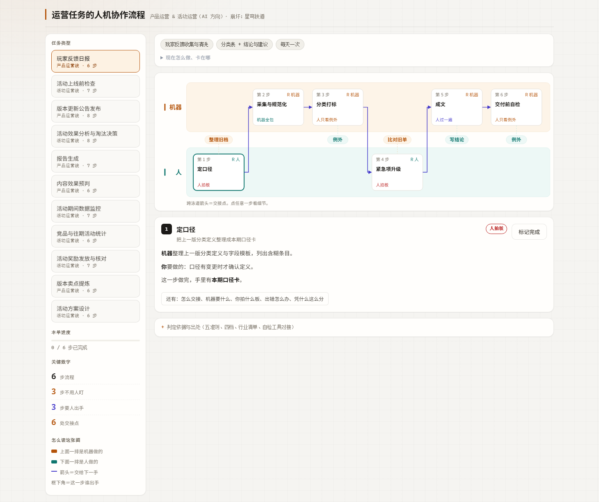
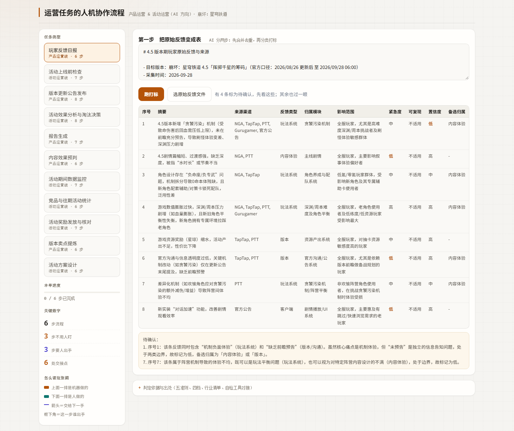
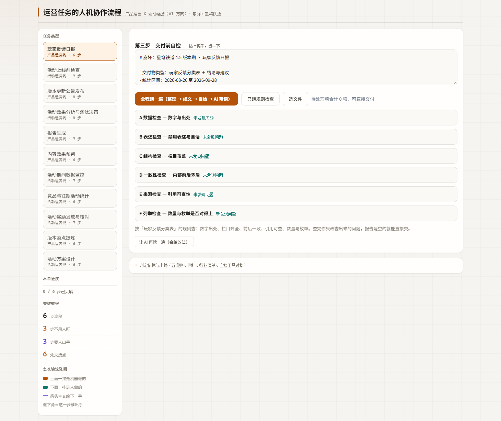

# OpsFlow · 运营任务 AI 分工与评测工具

> 本仓库内容用于求职展示，欢迎阅读与讨论；引用其中的分析、结论或设计请注明来源。

游戏运营的日常里有一批重复任务：玩家反馈收集与清洗、版本公告发布前核对、活动奖励发放核对、报告生成、活动期间数据监控。这些任务每一步都要回答同一个问题，哪一段是机械的、可以交给机器，哪一段要判断、人得留下。

这个仓库把 12 项岗位任务里的 11 项画成 74 步流程，每一步写清六件事：AI 做什么、人做什么、在哪交接、产出什么、出错怎么办、凭什么这么分。第 12 项「福利规划与付费点设计」没有画，理由写在流程数据里，覆盖率校验会要求这笔账平。

除了流程本身，仓库里还有一份能离线打开的单文件网页，和一套能自己跑出数字的检查脚本。网页用来读流程，脚本用来算结果。

## 一、工具页

`运营场景人机协作流程工具.html` 双击就能打开，不用装依赖，也不用联网。左边选任务，右边是泳道图，上面一排除机器做的动作，下面一排除人做的动作，跨泳道的箭头就是交接点。规则检查、流程单导出都在同一个页面里。

定口径、风险定级、写结论、签字放行这四类动作没有交给机器。分工的判据有五条：量、规则清晰度、错误代价、数据可得性、判断需求。自动化分四级，档一才允许全自动，档四只能由人决策。每一步用的是哪条判据，都写在流程数据里。

## 二、规则与自检

页面内嵌的流程数据和 `运营自检/checklist.json` 同源。六类交付物各有一组规则，A 到 F 六个模块分别查数字出处、绝对化表述、必含栏目、数值一致性、引用出处、数量与枚举。改规则改 JSON 就行，不用动页面代码。

`tests/verify_flows.py` 校验每步的 14 个必填字段、判定依据、引用出处和岗位覆盖率，漏一项就报错；页面内嵌的规则和规则库逐字段比对，不一致也报错。

`知识条目清单.md` 里是 150 条可查条目，每条写了内容、出处、被哪条自检规则检查。条目按固定字段存、按固定规则查，没有向量检索，也不做语义召回。

## 三、界面

泳道图把机器与人的动作分两行画出来，跨泳道的箭头就是交接点。



打标结果里，置信度低的条目会单独标出来，人只看被标红的几行。



成稿交给规则检查后，逐条列出问题、所在行与改法。



## 四、实测数据

| 项 | 实测 | 证据文件 |
| --- | --- | --- |
| 岗位任务覆盖 | 11 / 12 项，另 1 项登记为不画并写明理由 | `测试留档/verify_flows.py.log` |
| 流程步骤与交接点 | 74 步、74 处 | `测试留档/verify_flows.py.log` |
| 规则评测检出率 | 39 / 39，100.0% | `测试留档/eval.py.log`、`运营自检/golden_truth.json` |
| 误报率 | 0.0%，疑似误报 0 项 | `测试留档/eval.py.log` |
| 分模块 P/R/F1 | A 到 F 六模块均为 1.000 | `评测报告.md` 第三节 |
| 跨引擎一致性 | 4 / 4 份样例两边一致，逐份 15、7、9、5 项 | `测试留档/smoke_test.js.log` |
| 负向测试 | 8 / 8 组被拦住，跑完自动还原 | `测试留档/负向测试-v332.py.log`、`测试留档/负向测试-泳道图布局.py.log` |
| 泳道图布局 | 11 / 11 个任务的文字不越界、不重叠 | `测试留档/test_layout.py.log` |
| 真实材料校准 | 六轮，第 1 轮暴露 6 个问题，据此把打标拆成两次调用 | `docs/六轮校准总结.md` |
| 公开渠道案例 | 41 条原始反馈合并去重成 7 条，自检第 1 次报 3 项、第 2 次 0 项 | `案例-玩家反馈日报/03_过程说明.md` |
| 大模型稳定性 | 同一稿同一提示词 9 次调用，5 次报问题、4 次答「无」，温度降到 0 后仍不消除 | `docs/测试报告.md` |

表格最后一行说的是一种情况：模型同一份稿子跑九次，有五次报问题、四次说没问题。所以规则检查还得留着，它比模型稳定，但也只能收窄波动，消除不了。页面上的 AI 审读因此定位成多一双眼睛，不是一道关。

评测层的补项与出处见 `评测报告.md` 第三到第七节。分模块 P/R/F1 参照 `nityaattili/AI-feedback-categoriser` 的 `evaluate.py`，版本键 drift 日志参照 `ozlar34/llm-judge-evals` 的 `drift-log.jsonl`，两项都写了独立验证脚本与负向测试。人工校准集与人工评分表按 `mrjunos/llm-eval-harness` 与 `Liyao9797/game-customer-support-agent` 的结构备好，评分与判定栏留空待真人填写。

## 五、怎么跑

```bash
# 1 双击 运营场景人机协作流程工具.html，选一个任务看机器泳道与人泳道
# 2 一条命令出评测报告，读仓库里已留档的测试输出，不用联网、不用凭据
python eval_report.py
# 3 想验评测层补项，两条命令
python 验证-分模块PRF1.py
python 验证-drift日志.py
```

在线访问：https://ahah-bit.github.io/ops-task-flow/ 。工具页直接打开：https://ahah-bit.github.io/ops-task-flow/运营场景人机协作流程工具.html 。页面与仓库内的 `运营场景人机协作流程工具.html` 是同一份，打开即用，不需要安装依赖。

公开版页面不含任何访问凭据。界面上的 AI 按钮会提示没有可用的凭据，规则检查、泳道图、导出流程单照常用。要复跑真调用那套测试，见 `docs/怎么复跑测试.md`。

## 六、出处与借鉴

行业框架引用一律附出处与年份，本项目没有自提方法论：MDA 2004、GameFlow 2005、心流理论 1990、Quantic Foundry 2016、AARRR 2007、HEART 2010，逐条登记在 `docs/调研与出处.md`。行业检查清单逐条标了原文来源，见 `知识条目清单.md` 的行业检查清单一节。

两个只作为外部佐证、没有并入代码的出处：

- `Julez14/feedback-analyzer` 的 `docs/Design_Decisions.md`，把 D1 的确定性 counts 与 AI Search 的主题分两层，和本项目把算数交给代码的做法一致。
- `ForceInjection/ai-native-devops` 的 `ai-native-devops.md` 第 4.5 节 RACI，A 由人承担，和本项目把定口径、风险定级、写结论、签字放行留给人的分工一致。

评测层四项借鉴的仓库名、文件路径与下载日期写在 `评测报告.md` 里。七个参考仓库只用来读评测设计，代码没有并入。

## 七、不做的方向

按 `项目台账-运营Agent.md` 第七节，以下方向不碰：工单闭环与飞书协同、RAG 与向量检索、多智能体编排、React 全栈重写，以及「人情味」这类没有场景支撑的主观指标。单文件、能离线是这份工具的优点，不值得拿它换一个跑不起来的架构。

## 八、许可证

代码采用 Apache-2.0，文档与设计稿采用 CC BY-NC-SA 4.0。版权与素材来源声明见 `LICENSE` 与 `NOTICE`。
